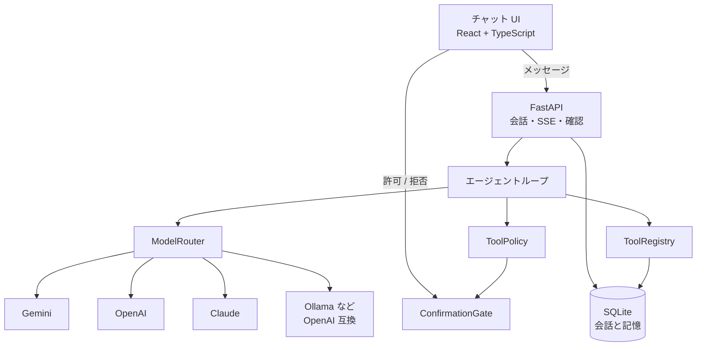

# ヤタ（Yata）

調べる、読む、ブラウザを動かす。個人のための汎用 AI アシスタントです。名前のヤタは、神武天皇を導いた八咫烏（やたがらす）から来ています。道を示す案内役、という役割です。

モデルがツールを呼び、結果を見て、もう一度考える。その途中経過がチャットに流れ、クリックや入力の前には確認が入ります。会話と、ユーザーについての短い記憶は SQLite に残ります。

ZEN University で AI エンジニアを目指すための個人プロジェクトです。毎日使うこと、就職用のポートフォリオに載せること、あとからサービスとして出せる形にしておくこと、の3つを同時に満たす最初の版です。

## 起動

API キーを1つ用意します。Gemini、OpenAI、Anthropic のどれかで動きます。キーがなくても、内蔵のデモモデルでツールの流れは確認できます。

```bash
cp .env.example .env
# .env に GEMINI_API_KEY など、どれか1つ書く

./scripts/run.sh
```

ブラウザで [http://127.0.0.1:8741](http://127.0.0.1:8741) を開きます。初回の `./scripts/run.sh` は依存関係のインストールとフロントエンドのビルドも行います。2回目以降はサーバーを起動するだけです。

前提は Python 3.11 以上、[uv](https://docs.astral.sh/uv/)、Node.js 22 前後です。

```bash
uv run pytest          # テスト
uv run playwright install chromium   # ブラウザツールを使うとき
make dev               # API 8741 + Vite 8742（ホットリロード）
```

ブラウザ操作（クリック、入力、スクリーンショット）には Playwright の Chromium が必要です。未インストールでも検索・読解・記憶は動きます。ツールが失敗したときは、その理由がチャットに返ります。

## アーキテクチャ



1ターンの流れです。

```mermaid
sequenceDiagram
  participant UI as チャット
  participant API as FastAPI
  participant Loop as エージェント
  participant Model as LLM
  participant Gate as 確認
  participant Tool as ツール

  UI->>API: POST /messages
  API->>Loop: 履歴 + 記憶つき system
  Loop->>Model: ツール定義つきで問い合わせ
  Model-->>Loop: tool call
  Loop-->>UI: tool_call を SSE で送る
  alt リスクが mutate / external
    Loop->>Gate: 確認を開く
    Loop-->>UI: confirmation_required
    UI->>API: 許可または拒否
    API->>Gate: resolve
  end
  Loop->>Tool: 実行
  Tool-->>Loop: 観察
  Loop-->>UI: tool_result
  Loop->>Model: 観察を渡してもう一度
  Model-->>Loop: 回答
  Loop-->>UI: answer
```

| 場所 | 役割 |
| --- | --- |
| `src/yata/agent/loop.py` | 考える、ツールを呼ぶ、観察する、答える。ステップ上限つき |
| `src/yata/llm/` | `LLMProvider`。公式 SDK への変換は `convert.py` |
| `src/yata/tools/` | ツールのインターフェース、登録、検索、読解、ブラウザ、記憶 |
| `src/yata/confirm/gate.py` | 危険な操作を UI の別リクエストで許可する |
| `src/yata/memory/store.py` | 会話と事実の SQLite |
| `src/yata/api/app.py` | HTTP と SSE。ビルド済み UI も同じポートで配信 |
| `frontend/` | 日本語のチャット。モデル選択、途中経過、確認ダイアログ |

バックエンドは Python です。エージェント、Playwright、SQLite が同じプロセスにあり、ツール追加の型がそのまま読めます。画面は TypeScript です。会話の状態と SSE の扱いを型で固定するためです。

### モデルの差し替え

`LLMProvider` は `complete(messages, tools, model)` だけです。中のメッセージ型はプロバイダを知りません。Gemini、OpenAI、Anthropic、Ollama への翻訳はアダプタの仕事です。

LiteLLM のような単一ラッパーも候補でした。この版では公式 SDK（`google-genai`、`openai`、`anthropic`）を選んでいます。依存が小さく、ツール結果の形の違い（OpenAI は `tool` ロール、Anthropic は `tool_result`、Gemini は `function_response`）が `convert.py` に残るためです。Ollama、LM Studio、vLLM は OpenAI SDK の `base_url` を変えるだけです。モデル名は `.env` の `YATA_*_MODEL` で変えます。

キーが無いプロバイダはモデル一覧で「利用不可」になり、送信前に API が拒否します。

### ツールと確認

ツールは `name`、JSON Schema、`Risk`、`run()` を持つクラスです。登録は `tools/catalog.py` の `build_registry()` に1行足します。

| Risk | 意味 | 既定の扱い |
| --- | --- | --- |
| `read` | 検索、ページ読解、スクリーンショット | すぐ実行 |
| `write` | ローカルな記憶の保存 | すぐ実行 |
| `mutate` | ブラウザのクリックと入力 | 確認 |
| `external` | 将来のデスクトップ操作、メール、決済 | 確認 |

ループは `ToolPolicy` に聞くだけです。デスクトップ操作を足すときは、同じインターフェースで `Risk.EXTERNAL` のツールを登録します。確認の待ち方は変わりません。PC 全体のマウス操作はこの版の範囲外です。

検索は DuckDuckGo（`ddgs`、API キー不要）です。ページ読解は HTTP で取得し、本文だけを抜きます。リダイレクトのたびに URL を検査します。`169.254.169.254` と `metadata.google.internal` は常に拒否します。プライベートアドレスは `YATA_ALLOW_PRIVATE_URLS` で切り替えます。個人利用の既定は `true` です。公開するときは `false` にします。

ブラウザは会話ごとに1ページを持つヘッドレス Chromium です。セレクタは Playwright の記法（`text=次へ`、`role=button[name="検索"]`）です。

### 記憶

`conversations` と `messages` が LLM に渡す履歴です。画面用のトランスクリプトは、ツール呼び出しをそのターンの吹き出しに畳みます。`facts` は `save_memory` で書いた短い事実で、次のターンの system プロンプトに入ります。個人の規模なので SQLite の同期 API です。接続は呼び出しごとに開きます。

### ストリーミング

途中経過は Server-Sent Events です。`step`、`tool_call`、`confirmation_required`、`tool_result`、`answer`、`error` が届いた順に画面へ出ます。トークン単位の生成ストリームはまだありません。ツール判断を安定させるため、各ステップのモデル呼び出しは一括で受けています。

## 設定

`.env.example` が全部です。秘密は `.env` に置き、リポジトリには入れません。

| 変数 | 役割 |
| --- | --- |
| `GEMINI_API_KEY` | Google AI Studio |
| `OPENAI_API_KEY` | OpenAI |
| `ANTHROPIC_API_KEY` | Anthropic |
| `OLLAMA_BASE_URL` | 既定 `http://127.0.0.1:11434` |
| `YATA_MODEL` | 既定のモデル id（`gemini` / `openai` / `anthropic` / `ollama` / `demo`） |
| `YATA_*_MODEL` | 上流のモデル名 |
| `YATA_MAX_STEPS` | 1ターンのモデル呼び出し上限（既定 8） |
| `YATA_ALLOW_PRIVATE_URLS` | プライベートアドレスを開くか |

ローカルモデルはツール呼び出しに対応したものを選んでください。`ollama pull gemma3` のように入れ、`YATA_OLLAMA_MODEL` をその名前に合わせます。

## テスト

```bash
uv run pytest
```

ネットワークも API キーも使いません。

- プロバイダ変換と応答の解釈、キーの有無によるモデル一覧
- ツール登録、重複、未知の名前、引数検査、確認ポリシー
- モック LLM でのループ（直接回答、ツール後の回答、ステップ上限、確認の前後、拒否、未知ツール、例外、プロバイダエラー）
- SQLite の会話、事実、画面用トランスクリプト
- デモモデルでの HTTP 一往復

## ディレクトリ

```
src/yata/          エージェント、モデル、ツール、記憶、API
frontend/               チャット UI
tests/                  上記のテスト
scripts/run.sh          セットアップ済みなら、これだけで起動
.env.example            設定の見本
```

## ロードマップ

先の計画は [ROADMAP.md](ROADMAP.md) に分けてあります。いまの版は Phase 0（土台）です。次に着手するのは、ブラウザを閉じていても動く常駐とルーティンです。Grok Bot、Meta Muse、OpenAI Dots と同じ種類の個人エージェントへ向かう段階、各段階の成功条件、当面やらないこともそこに書いてあります。

## English

Yata (ヤタ) is a personal AI assistant. The name comes from Yatagarasu (八咫烏), the sacred three-legged crow that guided Emperor Jimmu. It is a guide that shows the way. An LLM chooses tools, observes the results, and answers. The chat shows each step as it happens. Clicks and typing wait for confirmation. History and a few long-term facts live in SQLite.

### Run

```bash
cp .env.example .env   # set one of GEMINI_API_KEY, OPENAI_API_KEY, ANTHROPIC_API_KEY
./scripts/run.sh       # installs deps on first run, then serves http://127.0.0.1:8741
uv run pytest
uv run playwright install chromium   # only for the browser tools
```

The built-in `demo` model needs no key. It is there to exercise the real loop and the real tools, and it says so in the UI.

### Stack

Python and FastAPI own the agent, because that is where the tool loop, Playwright, and SQLite sit. The UI is React, TypeScript, Tailwind, and shadcn/ui, served by the same process after `npm run build`.

Providers implement one method, `complete(messages, tools, model)`. Adapters use the official SDKs (`google-genai`, `openai`, `anthropic`) rather than a universal wrapper. The tool-call translation stays in `llm/convert.py`, where the differences are readable: OpenAI `tool` messages, Anthropic `tool_result` blocks, Gemini `function_response` parts. Ollama and any other OpenAI-compatible server reuse the OpenAI adapter with a different `base_url`. LiteLLM would collapse that into one dependency. It is a fair choice when the goal is maximum provider coverage with less code. Here the goal is a small install and an obvious seam, so a new provider is a new adapter plus a row in `ModelRouter`.

Tools are classes with a JSON schema and a `Risk`. `read` and `write` run immediately. `mutate` (browser click and type) and `external` (the slot for future desktop control, mail, and payments) go through `ConfirmationGate`. The loop asks the policy. It does not special-case tools. Desktop control is not implemented. The gate and the risk enum are the extension point.

Search uses DuckDuckGo via `ddgs` (no key). Page reading checks every redirect. The cloud metadata address is always blocked. Private hosts are allowed only when `YATA_ALLOW_PRIVATE_URLS=true`, which is the personal default and should be turned off before a public deploy.

### Roadmap

The longer plan is in [ROADMAP.md](ROADMAP.md). This repository is Phase 0. The recommended next step is an always-on process and scheduled routines, on the way toward a Grok Bot, Meta Muse, and OpenAI Dots class of personal agent.
