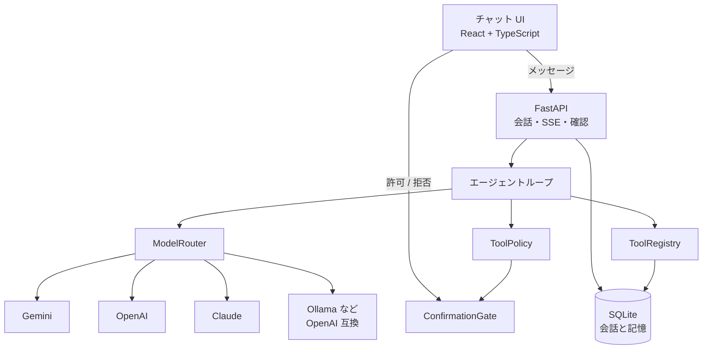

# ヤタ（Yata）

<p align="center"></p>

**ヤタは、チャットで話しかけるだけで、調べものや毎日の作業を手伝ってくれる AI アシスタントです。** 日本語で話しかけてください。あなたの PC の中で動き、会話や記録も PC の中に保存します。

<!-- スクリーンショット: docs/images/screenshot-chat.png を置いたら、次の行のコメントを外す -->
<!--  -->

## ヤタでできること

- **調べもの**：Web で検索して、ページを読み、要点をまとめます。
- **メールと予定**：Gmail を読んだり下書きを作ったりします。Google カレンダーの予定や空き時間も確認できます。
- **LINE から話しかける**：スマホの LINE からヤタに質問できます。
- **いつものサービスとつながる**：Chatwork のメッセージやタスク、Backlog の課題、kintone のレコード、freee とマネーフォワード クラウド請求書の請求書、LINE 公式アカウントのお知らせ配信、楽天市場の商品検索に対応しています。
- **日本の仕事の計算**：祝日・営業日・和暦の計算、インボイス（適格請求書）の消費税の計算をします。敬語の文面も書きます。
- **決まった作業を自動で**：「毎朝8時にニュースを要約して」のように頼むと、毎日その時刻に実行します。結果を LINE に届けることもできます。
- **覚えておく**：あなたについての短いメモを覚えて、次の会話に活かします。
- **ブラウザを動かす**：Web ページを開いて、クリックや入力をします。

<!-- デモ GIF: docs/images/demo-line.gif を置いたら、次の行のコメントを外す -->
<!--  -->

## 安心して使うために

- **外に出る操作は、必ずあなたが許可してから。** メールやメッセージの送信、予定の作成、経費の登録などの前に「許可する」「拒否する」を聞きます。
- **データは手元に。** 会話や記録は PC の中に保存します。AI への質問だけは、選んだ AI サービスに送られます（Ollama なら PC の外にも出ません）。
- **AI は自分で選べます。** Gemini、OpenAI、Anthropic、xAI（Grok）、DeepSeek、Kimi、Mistral、Groq、OpenRouter、PLaMo のどれかの API キーを1つ用意します。Gemini の無料枠や、PC の中で動く AI（Ollama・LM Studio・llama.cpp・Jan・vLLM・LocalAI など）を使えば、無料でも使えます。
- **完全オフラインモード。** 設定でオンにすると、PC の中の AI だけを使い、ネット検索・ブラウザ・外部の連携・LINE への通知を止めます。会話が PC の外に出ません。

## はじめかた（Windows）

**アプリ版（かんたん）**：Microsoft Store の「入手」か、[Releases](https://github.com/koheip/yata/releases) の `Yata-Setup-<版>.exe` を開くだけで入ります（いまは配布の準備中です。作り方は [docs/distribution.md](docs/distribution.md)）。

**ソースから動かす**：[uv](https://docs.astral.sh/uv/) と [Node.js](https://nodejs.org/) と Git が入っていれば、PowerShell で次の1行を実行するだけで準備できます。

```powershell
git clone https://github.com/koheip/yata.git; cd yata; powershell -ExecutionPolicy Bypass -File scripts\install.ps1
```

足りないものがあれば、スクリプトが入れ方を案内します（勝手にはインストールしません）。準備ができたら `uv run yata` で起動します。はじめて開くと「AI をつなぎましょう」という案内が出るので、画面の手順どおりに API キーを貼り付けてください（Google Gemini なら無料です）。`.env` を書きかえる必要はありません。ヤタ専用のウィンドウで画面が自動で開きます（開かないときは <http://127.0.0.1:8741> をブラウザで開いてください）。

---

ここから下は、開発者向けの説明です。

調べる、読む、ブラウザを動かす。個人のための汎用 AI アシスタントです。名前のヤタは、神武天皇を導いた八咫烏（やたがらす）から来ています。道を示す案内役、という役割です。

モデルがツールを呼び、結果を見て、もう一度考える。その途中経過がチャットに流れ、クリックや入力の前には確認が入ります。会話と、ユーザーについての短い記憶は SQLite に残ります。

ZEN University で AI エンジニアを目指すための個人プロジェクトです。毎日使うこと、就職用のポートフォリオに載せること、あとからサービスとして出せる形にしておくこと、の3つを同時に満たす最初の版です。

## 起動

API キーを1つ用意します。Gemini、OpenAI、Anthropic のどれかで動きます。キーがなくても、内蔵のデモモデルでツールの流れは確認できます。

```bash
cp .env.example .env
# .env に GEMINI_API_KEY など、どれか1つ書く

./scripts/run.sh
```

ブラウザで [http://127.0.0.1:8741](http://127.0.0.1:8741) を開きます。初回の `./scripts/run.sh` は依存関係のインストールとフロントエンドのビルドも行います。2回目以降はサーバーを起動するだけです。

前提は Python 3.11 以上、[uv](https://docs.astral.sh/uv/)、Node.js 22 前後です。

```bash
uv run pytest          # テスト
uv run playwright install chromium   # ブラウザツールを使うとき
make dev               # API 8741 + Vite 8742（ホットリロード）
```

ブラウザ操作（クリック、入力、スクリーンショット）には Playwright の Chromium が必要です。未インストールでも検索・読解・記憶は動きます。ツールが失敗したときは、その理由がチャットに返ります。

## アーキテクチャ



1ターンの流れです。

```mermaid
sequenceDiagram
  participant UI as チャット
  participant API as FastAPI
  participant Loop as エージェント
  participant Model as LLM
  participant Gate as 確認
  participant Tool as ツール

  UI->>API: POST /messages
  API->>Loop: 履歴 + 記憶つき system
  Loop->>Model: ツール定義つきで問い合わせ
  Model-->>Loop: tool call
  Loop-->>UI: tool_call を SSE で送る
  alt リスクが mutate / external
    Loop->>Gate: 確認を開く
    Loop-->>UI: confirmation_required
    UI->>API: 許可または拒否
    API->>Gate: resolve
  end
  Loop->>Tool: 実行
  Tool-->>Loop: 観察
  Loop-->>UI: tool_result
  Loop->>Model: 観察を渡してもう一度
  Model-->>Loop: 回答
  Loop-->>UI: answer
```

| 場所 | 役割 |
| --- | --- |
| `src/yata/agent/loop.py` | 考える、ツールを呼ぶ、観察する、答える。ステップ上限つき |
| `src/yata/llm/` | `LLMProvider`。公式 SDK への変換は `convert.py` |
| `src/yata/tools/` | ツールのインターフェース、登録、検索、読解、ブラウザ、記憶 |
| `src/yata/confirm/gate.py` | 危険な操作を UI の別リクエストで許可する |
| `src/yata/memory/store.py` | 会話と事実の SQLite |
| `src/yata/api/app.py` | HTTP と SSE。ビルド済み UI も同じポートで配信 |
| `frontend/` | 日本語のチャット。モデル選択、途中経過、確認ダイアログ |

バックエンドは Python です。エージェント、Playwright、SQLite が同じプロセスにあり、ツール追加の型がそのまま読めます。画面は TypeScript です。会話の状態と SSE の扱いを型で固定するためです。

### モデルの差し替え

`LLMProvider` は `complete(messages, tools, model)` だけです。中のメッセージ型はプロバイダを知りません。Gemini、OpenAI、Anthropic、Ollama への翻訳はアダプタの仕事です。

LiteLLM のような単一ラッパーも候補でした。この版では公式 SDK（`google-genai`、`openai`、`anthropic`）を選んでいます。依存が小さく、ツール結果の形の違い（OpenAI は `tool` ロール、Anthropic は `tool_result`、Gemini は `function_response`）が `convert.py` に残るためです。Ollama、LM Studio、vLLM は OpenAI SDK の `base_url` を変えるだけです。モデル名は `.env` の `YATA_*_MODEL` で変えます。

キーが無いプロバイダはモデル一覧で「利用不可」になり、送信前に API が拒否します。

### ツールと確認

ツールは `name`、JSON Schema、`Risk`、`run()` を持つクラスです。登録は `tools/catalog.py` の `build_registry()` に1行足します。

| Risk | 意味 | 既定の扱い |
| --- | --- | --- |
| `read` | 検索、ページ読解、スクリーンショット、Gmail/カレンダーの参照 | すぐ実行 |
| `write` | ローカルな記憶の保存、Gmail の下書き作成 | すぐ実行 |
| `mutate` | ブラウザのクリックと入力 | 確認 |
| `external` | デスクトップ操作（未実装）、メール送信、予定の作成・更新・削除、決済 | 確認 |

ループは `ToolPolicy` に聞くだけです。デスクトップ操作を足すときは、同じインターフェースで `Risk.EXTERNAL` のツールを登録します。確認の待ち方は変わりません。PC 全体のマウス操作はこの版の範囲外です。

Gmail とカレンダーのツールは `required_connector` を持ち、対応する連携が「接続済み」でないときはモデルに提示されません（`tools/catalog.py` の `visible_registry()`）。キー未設定やアカウント未接続でもアプリは普通に起動し、該当のツールが見えないだけです。

検索は DuckDuckGo（`ddgs`、API キー不要）です。ページ読解は HTTP で取得し、本文だけを抜きます。リダイレクトのたびに URL を検査します。`169.254.169.254` と `metadata.google.internal` は常に拒否します。プライベートアドレスは `YATA_ALLOW_PRIVATE_URLS` で切り替えます。個人利用の既定は `true` です。公開するときは `false` にします。

ブラウザは会話ごとに1ページを持つヘッドレス Chromium です。セレクタは Playwright の記法（`text=次へ`、`role=button[name="検索"]`）です。

### ルーティン

ブラウザを閉じても、ヤタのプロセスが動いていれば、決めた時刻に同じエージェントループが動きます。結果はルーティン専用の会話に残り、次に開いたときに読めます。危険なツール（クリックや入力）は、誰も見ていないときは「確認待ち」になり、開いたときに許可か拒否を聞きます。

サイドバーの「ルーティン」から追加できます。名前、指示、時刻（毎朝 8:00、毎時、毎週月曜 9:00、または cron）です。チャットに次のように送っても登録できます。

```text
毎朝8時にニュースを要約して
```

時刻は `YATA_TIMEZONE`（既定 `Asia/Tokyo`）です。サーバーは `./scripts/run.sh` のまま起動しておきます。ターミナルを閉じたあとも生かす Windows サービスや、OS の通知はまだありません。

### 連携（Gmail / Google カレンダー）

サイドバーの「連携」に、Gmail と Google カレンダーの状態（未設定 / 未接続 / 接続済み）と、接続・切断ボタンが出ます。未設定のときは、この画面に設定手順が日本語で表示されます。

設定の流れ（Google Cloud Console）:

1. [Google Cloud Console](https://console.cloud.google.com/) でプロジェクトを作成し、「API とサービス」→「ライブラリ」で **Gmail API** と **Google Calendar API** を有効にします。
2. 「API とサービス」→「OAuth 同意画面」で、ユーザーの種類を「外部」にし、自分の Google アカウントを「テストユーザー」に追加します（アプリの審査は不要です）。
3. 「API とサービス」→「認証情報」→「認証情報を作成」→「OAuth クライアント ID」で、アプリケーションの種類に **デスクトップアプリ** を選んで作成します。
4. 作成したクライアントの `client_secret*.json` をダウンロードします。
5. `.env` に次のどちらかを設定します。
   - `GOOGLE_OAUTH_CLIENT_SECRET_FILE` に、ダウンロードした JSON ファイルのパスを書く（推奨）。
   - または `GOOGLE_OAUTH_CLIENT_ID` と `GOOGLE_OAUTH_CLIENT_SECRET` に、JSON の中の値を直接書く。
6. サーバーを再起動し、「連携」画面の「接続」を押します。ブラウザが Google の同意画面に移動し、許可すると `http://127.0.0.1:8741` に戻ってきます（この待受けは追加のプロセスを起動せず、ヤタ自身の FastAPI が処理します）。
7. 「切断」を押すと、ローカルに保存したトークン（`data/connectors/`）が削除されます。

カレンダーの空き時間確認（`calendar_check_free_busy`）には `calendar.events.freebusy` スコープが必要です。このスコープが増える前に Google カレンダーを接続済みの場合は、一度「切断」してから再度「接続」し、新しいスコープで同意し直してください。

メールの送信、予定の作成・更新・削除は、確認ダイアログで内容を見せてから許可したときだけ実行されます。ルーティンから呼ばれた場合も同じで、誰も見ていないときは「確認待ち」のまま止まります。

### LINE 連携

LINE からヤタと双方向にチャットできます。確認が必要な操作には「許可する」「拒否する」ボタンが表示されます。`line_push_message`（LINE に送信）は実行前に確認し、許可ユーザー一覧の先頭にある自分の LINE に送ります。ルーティンごとの「LINE通知」をオンにすると、実行結果やエラーを自分の LINE に通知します。この通知は利用者が設定したものとして、実行ごとの確認なしで送ります。

Webhook はメイン UI と別のサーバーで、`127.0.0.1:8742` の `/line/webhook` と `/line/health` だけを提供します。署名検証と userId の許可リストで受信を制限します。トンネルで公開するのはこの Webhook サーバーだけです。8741 のメイン UI は公開しません。

1. [LINE Developers コンソール](https://developers.line.biz/console/) で LINE Official Account（公式アカウント）と Messaging API チャネルを用意します。公式アカウントを作り、LINE Official Account Manager から Messaging API を有効にするとチャネルが作成されます。
2. チャネル基本設定のチャネルシークレットと、Messaging API設定のチャネルアクセストークン（長期）を取得します。
3. `.env.example` の LINE セクションを参考に、自分の `.env` に `LINE_CHANNEL_SECRET`、`LINE_CHANNEL_ACCESS_TOKEN`、`LINE_ALLOWED_USER_IDS` を設定します。自分の userId はチャネル基本設定の「あなたのユーザーID」で確認できます。未許可ユーザーからメッセージが来たときのログにも、userId と `LINE_ALLOWED_USER_IDS` の設定ヒントが出ます。複数指定する場合はカンマ区切りにし、自分を先頭に置いてください。
4. ヤタを起動し、別の PowerShell で `./scripts/line-tunnel.ps1` を実行します。既定の `LINE_WEBHOOK_PORT=8742` を変更する場合は、ヤタを再起動してください。
5. LINE Developers の Webhook URL に `<public>/line/webhook`（表示された公開 HTTPS URL に `/line/webhook` を追加）を設定し、「検証」を実行して「Webhookの利用」をオンにします。
6. LINE Official Account Manager で「応答メッセージ」をオフにし、公式アカウントを友だち追加してメッセージを送ります。

cloudflared の quick tunnel URL は起動のたびに変わるため、その都度コンソールの Webhook URL を更新してください。ngrok の無料固定ドメインなら URL は変わりません。`ngrok http 8742`、または `ngrok http --url=<your>.ngrok-free.app 8742` を利用できます。ポートを変更した場合はコマンドの番号も合わせてください。

無料のコミュニケーションプランは 200 通/月です。返信（reply）は無料で、push とルーティンの LINE 通知は通数に数えられます。

### 記憶

`conversations` と `messages` が LLM に渡す履歴です。画面用のトランスクリプトは、ツール呼び出しをそのターンの吹き出しに畳みます。`facts` は `save_memory` で書いた短い事実で、次のターンの system プロンプトに入ります。個人の規模なので SQLite の同期 API です。接続は呼び出しごとに開きます。

### ストリーミング

途中経過は Server-Sent Events です。`step`、`tool_call`、`confirmation_required`、`tool_result`、`answer`、`error` が届いた順に画面へ出ます。トークン単位の生成ストリームはまだありません。ツール判断を安定させるため、各ステップのモデル呼び出しは一括で受けています。

## 設定

`.env.example` が全部です。秘密は `.env` に置き、リポジトリには入れません。

| 変数 | 役割 |
| --- | --- |
| `GEMINI_API_KEY` | Google AI Studio |
| `OPENAI_API_KEY` | OpenAI |
| `ANTHROPIC_API_KEY` | Anthropic |
| `OLLAMA_BASE_URL` | 既定 `http://127.0.0.1:11434` |
| `YATA_MODEL` | 既定のモデル id（`gemini` / `openai` / `anthropic` / `xai` / `deepseek` / `kimi` / `mistral` / `groq` / `openrouter` / `plamo` / `ollama` / `lmstudio` / `llamacpp` / `jan` / `vllm` / `custom` / `demo`） |
| `XAI_API_KEY` など | ほかの AI のキー（`DEEPSEEK_` `KIMI_` `MISTRAL_` `GROQ_` `OPENROUTER_` `PLAMO_`）。`*_MODEL` でモデル名も指定できる（空ならキー保存時に選ぶ） |
| `LMSTUDIO_BASE_URL` など | PC の中の AI の URL（`LLAMACPP_` `JAN_` `VLLM_`）。既定は各アプリの標準ポート |
| `CUSTOM_LLM_BASE_URL` / `CUSTOM_LLM_MODEL` / `CUSTOM_LLM_API_KEY` | その他の OpenAI 互換サーバー |
| `YATA_LOCAL_BROWSER_TOOLS` | PC の中の AI にもブラウザ操作のツールを渡す（既定 `false`。小さいモデルが迷わないように） |
| `YATA_OFFLINE` | 完全オフラインモード（既定 `false`。設定画面でも切り替えられる） |
| `BACKLOG_SPACE` / `BACKLOG_API_KEY` | Backlog のスペースの URL と API キー |
| `KINTONE_DOMAIN` / `KINTONE_API_TOKENS` | kintone の URL とアプリの API トークン（カンマ区切り） |
| `MONEYFORWARD_CLIENT_ID` / `MONEYFORWARD_CLIENT_SECRET` | マネーフォワード クラウド請求書のアプリ（アプリポータルで作成） |
| `YATA_*_MODEL` | 上流のモデル名 |
| `YATA_MAX_STEPS` | 1ターンのモデル呼び出し上限（既定 8） |
| `YATA_OPEN_BROWSER` | 起動したら画面を開く（既定 `true`。`--no-browser` でも止められる） |
| `YATA_APP_WINDOW` | Edge / Chrome の専用ウィンドウで開く（既定 `true`。`false` か `--browser-tab` でいつものブラウザのタブ） |
| `YATA_ALLOW_PRIVATE_URLS` | プライベートアドレスを開くか |
| `YATA_SCHEDULER_ENABLED` | ルーティンのスケジューラ（既定 `true`） |
| `YATA_SCHEDULER_INTERVAL_SECONDS` | 期限の確認間隔（既定 30 秒） |
| `YATA_TIMEZONE` | ルーティンの既定タイムゾーン（`Asia/Tokyo`） |
| `GOOGLE_OAUTH_CLIENT_SECRET_FILE` | ダウンロードした client_secret*.json のパス（推奨） |
| `GOOGLE_OAUTH_CLIENT_ID` / `GOOGLE_OAUTH_CLIENT_SECRET` | JSON を使わない場合の直接指定 |
| `LINE_CHANNEL_SECRET` | LINE チャネル基本設定のシークレット |
| `LINE_CHANNEL_ACCESS_TOKEN` | Messaging API のチャネルアクセストークン（長期） |
| `LINE_ALLOWED_USER_IDS` | 許可する userId（カンマ区切り、先頭が通知先） |
| `LINE_WEBHOOK_PORT` | Webhook 専用ポート（既定 `8742`、127.0.0.1 のみ） |

ローカルモデルはツール呼び出しに対応したものを選んでください。`ollama pull gemma3` のように入れ、`YATA_OLLAMA_MODEL` をその名前に合わせます。

## テスト

```bash
uv run pytest
```

ネットワークも API キーも使いません。

- プロバイダ変換と応答の解釈、キーの有無によるモデル一覧
- ツール登録、重複、未知の名前、引数検査、確認ポリシー
- モック LLM でのループ（直接回答、ツール後の回答、ステップ上限、確認の前後、拒否、未知ツール、例外、プロバイダエラー）
- SQLite の会話、事実、画面用トランスクリプト
- ルーティンの次回時刻、チャットからの登録、モック LLM での実行と確認待ち
- デモモデルでの HTTP 一往復
- 連携: トークンの保存・削除、OAuth の state 検証、Gmail/カレンダーのツールが未接続では隠れること、メール送信・予定の変更が必ず確認を経ること（モックした Google API）

## ディレクトリ

```
src/yata/          エージェント、モデル、ツール、記憶、ルーティン、連携、API
frontend/               チャット UI
tests/                  上記のテスト
scripts/run.sh          セットアップ済みなら、これだけで起動
packaging/              Windows アプリ版（PyInstaller・Setup.exe・MSIX）の設定
.github/workflows/      タグを push すると配布ファイルを作る
.env.example            設定の見本
```

## ロードマップ

先の計画は [ROADMAP.md](ROADMAP.md) に分けてあります。Phase 0 と、Phase 1 のプロセス内ルーティンまで入っています。ヤタは汎用の個人アシスタントで、最初の公開は自分の PC で動くオープンソースです。段階、成功条件、当面やらないことはロードマップに書いてあります。

## English

Yata (ヤタ) is a personal AI assistant. The name comes from Yatagarasu (八咫烏), the sacred three-legged crow that guided Emperor Jimmu. It is a guide that shows the way. An LLM chooses tools, observes the results, and answers. The chat shows each step as it happens. Clicks and typing wait for confirmation. History and a few long-term facts live in SQLite.

### Run

```bash
cp .env.example .env   # set one of GEMINI_API_KEY, OPENAI_API_KEY, ANTHROPIC_API_KEY
./scripts/run.sh       # installs deps on first run, then serves http://127.0.0.1:8741
uv run pytest
uv run playwright install chromium   # only for the browser tools
```

The built-in `demo` model needs no key. It is there to exercise the real loop and the real tools, and it says so in the UI.

Routines run inside the same process. Add one from the sidebar, or send `毎朝8時にニュースを要約して` in chat. The result is stored in that routine's conversation, so it is there the next time the tab opens. The server has to stay running; closing the browser tab is enough to leave. A Windows service and OS notifications are still later. Risky tools wait for confirmation instead of timing out immediately.

Gmail and Google Calendar connect from the sidebar's 連携 (Connectors) panel, which shows each one as not configured, not connected, or connected, with setup instructions in Japanese when no OAuth client is set. Create a Desktop-app OAuth client in Google Cloud Console (see the Japanese section above for the exact steps), point `GOOGLE_OAUTH_CLIENT_SECRET_FILE` or `GOOGLE_OAUTH_CLIENT_ID`/`GOOGLE_OAUTH_CLIENT_SECRET` at it, and press Connect. The OAuth loopback callback is handled by this same FastAPI process on `127.0.0.1:8741`; no extra server is started. Gmail search, read, and drafting and Calendar listing and free/busy checks run immediately (`Risk.READ`/`Risk.WRITE`). Sending mail and creating, updating, or deleting events are `Risk.EXTERNAL` and always wait on the same ConfirmationGate as everything else, including from routines. Tokens live under `data/connectors/`, never in git, and the connector tools simply are not offered to the model until the account is connected.

### Stack

Python and FastAPI own the agent, because that is where the tool loop, Playwright, and SQLite sit. The UI is React, TypeScript, Tailwind, and shadcn/ui, served by the same process after `npm run build`.

Providers implement one method, `complete(messages, tools, model)`. Adapters use the official SDKs (`google-genai`, `openai`, `anthropic`) rather than a universal wrapper. The tool-call translation stays in `llm/convert.py`, where the differences are readable: OpenAI `tool` messages, Anthropic `tool_result` blocks, Gemini `function_response` parts. Ollama and any other OpenAI-compatible server reuse the OpenAI adapter with a different `base_url`. LiteLLM would collapse that into one dependency. It is a fair choice when the goal is maximum provider coverage with less code. Here the goal is a small install and an obvious seam, so a new provider is a new adapter plus a row in `ModelRouter`.

Tools are classes with a JSON schema and a `Risk`. `read` and `write` run immediately. `mutate` (browser click and type) and `external` (the slot for future desktop control, mail, and payments) go through `ConfirmationGate`. The loop asks the policy. It does not special-case tools. Desktop control is not implemented. The gate and the risk enum are the extension point.

Search uses DuckDuckGo via `ddgs` (no key). Page reading checks every redirect. The cloud metadata address is always blocked. Private hosts are allowed only when `YATA_ALLOW_PRIVATE_URLS=true`, which is the personal default and should be turned off before a public deploy.

### Roadmap

The longer plan is in [ROADMAP.md](ROADMAP.md). Phase 0 and the in-process routines of Phase 1 are done. Yata is a general-purpose personal assistant. The first public release is the local open-source app, with a paid host later.
