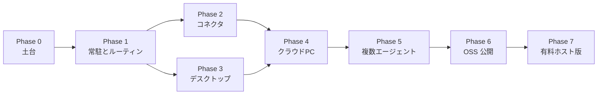

# ヤタ ロードマップ

ヤタは、汎用の個人用 AI アシスタントです。Grok Bot と同じ種類のもので、自分の PC の上で調べて、読んで、必要なときだけ手を動かし、危ないところでは止まります。八咫烏が道を示したように、業種を限った事務代行ではなく、その人の日常全般の案内役です。

最初の出し方は、GitHub でオープンソースにすることです。日本語を先にした、自分の PC で動くアシスタントにします。API キーは使う人が自分で用意します。Gemini の無料枠と、Ollama のローカルモデルなら、お金を払わなくても動かせます。差は、Gmail やカレンダーに加えて、LINE、Chatwork、freee、楽天のように日本で普段使うサービスとつながることです。

有料のホスト版は、そのあとです。インストール不要で、PC の電源が切れていてもルーティンが動きます。建てる前にウェイトリストを置き、価格はサーバーと LLM の原価を賄える水準にします。公開時のライセンスはまだ決めていません。候補は MIT と Apache-2.0 です。決めるのは OSS 公開の段階で、いま LICENSE を足したり差し替えたりはしません。

この文書は、ZEN University で作りながら毎日使い、作品として見せ、あとから人に渡すための地図です。Phase 0 と Phase 1 のスケジューラは入っています。それ以外は、まだ作っていません。

## いまあるもの (MVP)

Phase 0 と、Phase 1 のプロセス内スケジューラまでです。`./scripts/run.sh` のあと、ブラウザで http://127.0.0.1:8741 を開きます。

- **エージェントループ。** モデルが考え、ツールを呼び、結果を見て、また考える。1 ターンの上限は既定 8 ステップ（`YATA_MAX_STEPS`）。途中の `tool_call` や `tool_result` は SSE でチャットに流れる。トークン単位の生成ストリームはまだない。
- **差し替えできる LLM。** Gemini、OpenAI、Anthropic Claude、Ollama などの OpenAI 互換エンドポイント。画面のモデル選択と `YATA_MODEL` で切り替える。キーは `.env`。未設定のプロバイダは「利用不可」になり、送信前に API が断る。
- **デモモデル。** キーがなくても、本物のループと本物のツールで流れを確認できる。回答の品質を見るためのものではない。
- **ウェブ検索。** DuckDuckGo（`ddgs`、API キー不要）。
- **ページの取得。** HTTP で取り、本文だけを抜く。リダイレクトのたびに URL を検査する。`169.254.169.254` と `metadata.google.internal` は常に拒否する。プライベートアドレスは `YATA_ALLOW_PRIVATE_URLS`（個人利用の既定は `true`）。
- **Playwright のブラウザ。** 開く、本文を取る、クリック、入力、スクリーンショット。会話ごとに 1 ページのヘッドレス Chromium。クリックと入力は確認のあとで実行する。再起動するとログイン状態は残らない。
- **確認ゲート。** `Risk.MUTATE`（クリックと入力）は実行前にダイアログで止まる。`Risk.EXTERNAL`（将来の送信、決済、デスクトップ操作）も同じポリシーで止まる約束になっている。EXTERNAL のツールはまだ 1 つもない。ゲートはプロセスのメモリ上なので、サーバーを落とすと待ちの確認は消える。
- **記憶。** SQLite に会話履歴と、`save_memory` で残した短い事実。事実は次の system プロンプトに入る。埋め込み検索や、手順を保存するスキルはまだない。
- **日本語のチャット UI。** React。返信、ツールの途中経過、モデル選択、確認ダイアログ。
- **ルーティン。** SQLite に cron か間隔を保存し、同じプロセスの APScheduler がエージェントを呼ぶ。ブラウザのタブを閉じても、プロセスが生きていれば実行され、結果は会話に残る。確認が必要な操作は「確認待ち」になる。
- **テスト。** プロバイダ変換、ツール登録、モック LLM のループ、SQLite の記憶、ルーティン。`uv run pytest`。

サーバーのプロセスが動いているあいだのルーティンは入りました。Gmail と Google カレンダーも OAuth 連携として入りました（下の Phase 2 を参照）。まだないのは、ターミナルを閉じても残る Windows サービス、OS 通知、トレイアプリ、エージェント専用の仮想マシン、複数エージェント、OSS としての公開物、有料のホスト版です。

## 目指す姿（共通の5本柱）

Grok Bot、Muse、Dots に共通するのは、モデルの賢さそのものより、エージェントが自分の環境を持ち、人がいない時間も動き、実生活の道具とつながり、危ない操作の前で止まり、経験が残ることです。ヤタもこの 5 本で見ます。

1. **自分のコンピュータ。** ブラウザ、ファイル、ターミナルを、日常の操作と分けて持つ。いま持っているのは、会話のあいだだけのヘッドレス Chromium です。ファイルもシェルも、専用のマシンもありません。
2. **人不在でも動く。** 決めた時刻や間隔で調べ、結果を知らせる。タブを閉じても、ヤタのプロセスが動いていればルーティンは動きます。PC の電源を切っても動き続けるのは、有料ホスト版の仕事です。
3. **実生活の連携。** Gmail とカレンダーに加え、LINE、Chatwork、freee、楽天のように、日本で既に使っている場所とつながる。業種を決めた事務サービスではありません。
4. **危険操作の確認ゲート。** 送る、買う、消す、ログインする、画面を操作する、の前に人が許可する。クリックと入力はすでに止まります。外へ出る操作は、同じゲートに乗せます。
5. **積み上がる記憶・スキル。** 短い事実だけでなく、一度見せた手順をスキルとして残し、また呼べる。いま残るのは会話履歴と、数行の事実です。

## 段階計画

先に、自分の PC で毎日使える形を厚くします。コネクタとデスクトップの殻、そのあとエージェント自身のコンピュータと複数の役です。人に見せる最初の形は、その PC 上で動くオープンソースです。インストール不要の有料ホスト版は最後で、建てる前にウェイトリストを置きます。Phase 2 と Phase 3 は、Phase 1 のあとならどちらからでも着手できます。

### Phase 0 — 土台（完了）

ループ、モデルの差し替え、検索と読解、確認つきブラウザ、SQLite、日本語 UI、テスト。毎日の調べものに使え、コードを読めばどこにツールを足すかも分かります。

### Phase 1 — 常駐とルーティン（スケジューラまで完了）

ブラウザを閉じても、ヤタのプロセスが動いていればルーティンは実行されます。SQLite に cron か間隔を保存し、FastAPI の中の APScheduler が同じ `run_agent` を呼び、結果をそのルーティンの会話に残します。確認が必要な操作は、誰も見ていないあいだ「確認待ち」になり、次に開いた画面で許可できます。チャットに「毎朝8時にニュースを要約して」と送っても登録できます。

残しているのは、ターミナルを閉じてもプロセスが生きる Windows サービスと、OS の通知です。どちらも Phase 3 のトレイアプリと一緒に足します。それまでは `./scripts/run.sh` を起動したままにします。

### Phase 2 — コネクタ（Gmail と Google カレンダーまで完了）

個人のアシスタントが、日本で普段開いている場所とつながる段階です。業種向けの業務パッケージにはしません。

- Gmail と Google カレンダー。OAuth 2.0（PKCE つきの authorization code フロー）。トークンは `data/connectors/` に置き、git には入れない。接続・切断はサイドバーの「連携」画面から行う。
- 読み取り（検索・一覧・空き時間確認）は確認なしで実行する。`Risk.READ`。下書き作成も確認なし（`Risk.WRITE`）。
- 外へ出るメール送信（`gmail_send_email`）と、予定の作成・更新・削除（`calendar_create_event` など）は `Risk.EXTERNAL`。宛先・件名・本文や予定の内容を確認ダイアログに出し、許可のあとで実行する。ルーティンから呼ばれたときも同じゲートで止まる。
- 連携していない、または未設定のコネクタのツールはモデルに見せない。
- LINE、Chatwork、freee、楽天は、同じ `Connector` インターフェースのパターンで後から足す。いまはまだ実装していない。

### Phase 3 — デスクトップアプリ

中身のエージェントは FastAPI のままにします。殻だけをデスクトップにします。

- Electron または Tauri で、いまのウェブ UI を包む。
- システムトレイ、ログイン時の自動起動、ルーティン結果の OS 通知。
- ウィンドウを閉じてもプロセスは残る。停止はトレイから明示する。

新しいエージェントを殻の中に書き始めないこと。UI は今の React のまま載せます。

### Phase 4 — クラウド PC

エージェント自身のコンピュータです。Muse の Secure VM、Grok Bot の箱、Dots のデスクトップに相当します。有料ホスト版のマルチテナントとは別で、持ち主一人の作業机です。ルーティンと、少なくとも 1 つのコネクタが動いてから着手します。

- 日常の PC と分けた VM またはコンテナ。
- 再起動しても残るブラウザプロファイルとファイルシステム。
- 見たいときに見る画面。リモートデスクトップか、埋め込みの画面。途中で止められること。
- この箱を他人と共有し始めたら、プライベートアドレスは既定で拒否する。

### Phase 5 — 複数エージェントとスキル

1 人の汎用エージェントのままでは、手順が会話の中に溶けます。役を分け、手順を残します。

- 名前のついた専門エージェント。調べる役、文章にする役、予定を見る役。1 つの依頼の中で引き継ぐ。
- スキルは、プロンプトの文言だけではなく、実際に通ったツールの列から保存する。
- 保存したスキルは、Phase 1 のスケジューラから同じように呼べる。

### Phase 6 — OSS 公開

人に見せる最初の形は、GitHub 上のオープンソースです。日本語を先にした、自分の PC で動くアシスタントです。API キーは持ち込みです。Gemini の無料枠か Ollama なら、利用料なしで試し始められます。

この段階で揃えるものは次です。

- 日本語の README。知らない人が、自分の PC で何を入れるか分かる。
- ワンコマンドの導入。
- 動きが分かるデモの GIF または動画。
- ライセンス。候補は MIT と Apache-2.0。この段階で一つに決めて LICENSE を確定する。いまは決めていない。
- CONTRIBUTING。
- コミュニティへのリンクを置く場所。URL は後から埋めてよい。

### Phase 7 — 有料ホスト版

ローカル版が外で使われてから着手します。建てる前にウェイトリストを置き、欲しい人がいることを見てから作ります。

- インストール不要。ブラウザでアカウントを作って使う。
- PC の電源が切れていても、ルーティンが動き続ける。
- 認証、会話の所有者、ブラウザセッションの分離。SQLite から利用者ごとのデータベース（Postgres を想定）。
- 秘密の保管、利用量の上限。`YATA_ALLOW_PRIVATE_URLS=false` を既定にする。URL 検査はリクエスト直前の名前解決なので、公開時はリダイレクトと DNS 再バインドも見直す。
- 請求は Stripe。価格は、サーバーと LLM の原価を賄える水準にする。無料のローカル版と競って安くしない。

## やらないこと（当面）

- **業種特化の事務サービス。** 会計事務所向け、旅行業向け、といった業務パッケージにはしない。ヤタは汎用の個人アシスタントのまま、コネクタで日本の日常とつながる。
- **モデルの性能競争。** 基盤モデルは作らない。Gemini、Claude、GPT、ローカルモデルを借りる。差は道具、常駐、確認、記憶、日本のサービス連携に置く。
- **確認なしの PC 操作。** 画面全体のクリックやキー入力を足すときも `Risk.EXTERNAL` を通し、ブラウザのページ操作とはセッションを分ける。
- **秘密の同梱。** API キーも OAuth トークンも git に入れない。見本は `.env.example` だけ。

## 成功の定義

各段階で、できたかどうかを次のどれかで見ます。感想ではなく、手元で再現できることです。

| 段階 | できたと言えるとき |
| --- | --- |
| Phase 0（完了） | キー 1 つ、または demo で `./scripts/run.sh` が 8741 を開く。`uv run pytest` が通る。 |
| Phase 1（スケジューラまで完了） | サーバーが動いていれば、ブラウザを閉じても「毎朝 8 時にニュース要約」が会話に残る。ターミナルを閉じたあとも生かす Windows サービスは Phase 3。 |
| Phase 2（Gmail と Google カレンダーまで完了） | カレンダーの予定をチャットから読める。メールは下書きまで作り、確認で許可したときだけ送信される。LINE、Chatwork、freee、楽天のうち少なくとも 1 つが、同じ確認ゲートで外へ出る。 |
| Phase 3 | ログイン時に起動し、ウィンドウを閉じてもトレイに残る。ルーティンの結果が OS の通知になる。 |
| Phase 4 | 再起動してもブラウザのログインと作業ファイルが残る。所有者はその画面を見て、途中で止められる。 |
| Phase 5 | 調べる役とまとめる役が 1 つの依頼で引き継ぐ。保存したスキルを、翌日のルーティンから呼べる。 |
| Phase 6 | 日本語 README とワンコマンドで、他人の PC に入る。デモの GIF か動画、CONTRIBUTING、コミュニティ用リンクの置き場がある。ライセンスは MIT か Apache-2.0 のどちらかに決まっている。 |
| Phase 7 | ウェイトリストが先にあり、そのあとホスト版ができる。PC を切ってもルーティンが動き、Stripe で請求できる。価格がサーバーと LLM の原価を下回らない。 |

## English

Yata (ヤタ) is a general-purpose personal AI assistant in the same class as Grok Bot: it runs on your own computer, uses tools, and stops before anything risky. The name comes from Yatagarasu (八咫烏), the crow that showed Emperor Jimmu the way. It is not an industry-specific office product.

The first public release is open source on GitHub: a Japanese-first assistant that runs locally. People bring their own API keys. Gemini's free tier and Ollama mean it can cost nothing to run. The difference from a plain chat app is Japan-specific connections — LINE, Chatwork, freee, and Rakuten — next to Gmail and Calendar.

A paid hosted version comes later: no install, routines that keep running while the PC is off, Stripe billing, and a waitlist before any of that is built. The price should cover server and LLM costs. The public license is not chosen yet. MIT and Apache-2.0 are the candidates, and the choice belongs to the open-source release, not to this note. Phase 0 and the in-process scheduler of Phase 1 are done. Everything after that is still a plan.

### What exists

A local agent loop with a step cap and server-sent tool steps. Pluggable Gemini, OpenAI, Claude, and an OpenAI-compatible endpoint such as Ollama, plus a keyless demo model. DuckDuckGo search, page fetch with a URL guard, and a Playwright browser whose clicks and typing wait on a confirmation dialog. SQLite conversations, short facts, and scheduled routines. A Japanese React chat. `./scripts/run.sh` serves the API and the UI on one port. Tests cover providers, the tool registry, the loop, memory, and routines.

Routines run from an APScheduler tick inside the FastAPI process, including when the browser tab is closed. A run that needs confirmation stays `waiting_confirmation` until someone approves it. Gmail and Google Calendar connect through OAuth from a sidebar panel (see Phase 2 below). Not built yet: a Windows service or tray process, OS notifications, a persistent VM, specialist agents, the open-source release checklist, and the paid host. `Risk.EXTERNAL` now covers mail and calendar writes; nothing else uses it yet. The confirmation gate is in memory. The browser profile does not survive a restart. There is no token streaming and no retrieved long-term memory.

### Five pillars

1. A computer of its own: browser, files, and a terminal, separate from the daily machine.
2. Work while the owner is away. The tab can close and routines still run, as long as the process is up. Running while the PC is off is the hosted product.
3. Real-life connectors: Gmail, Calendar, and the Japan-specific set LINE, Chatwork, freee, and Rakuten.
4. A confirmation gate before anything risky.
5. Memory and skills that accumulate.

### Phases

Phase 0, the foundation, is done. Phase 1's scheduler is done: "summarize the news at 8:00 every morning" runs while the server process is up, and the result is waiting in chat. A Windows service that survives a closed terminal remains part of Phase 3.

Phase 2's Gmail and Google Calendar connectors are in. OAuth 2.0 with PKCE; tokens live under `data/connectors/` and stay out of git; connect and disconnect happen from the sidebar's connectors panel. Reading mail and calendar, and creating a draft, run without confirmation (`Risk.READ`/`Risk.WRITE`). Sending mail (`gmail_send_email`) and creating, updating, or deleting events (`calendar_create_event` and friends) are `Risk.EXTERNAL` and always wait on the same confirmation gate, including from routines. Tools for a connector that is not configured or not connected are simply not offered to the model. LINE, Chatwork, freee, and Rakuten come after this, through the same `Connector` interface. Success: calendar reads work from chat, and unapproved mail is never sent — both hold today.

Phase 3 wraps the current web UI in Electron or Tauri. Tray, login auto-start, OS notifications. FastAPI stays the backend. Success: the window can close and the process remains, and a routine raises an OS notification.

Phase 4 is the agent's own computer: an isolated VM or container, a persistent browser profile, a filesystem, and a view the owner can watch and stop. This is the Muse Secure VM / Grok Bot box / Dots desktop step. It is one person's desk, not the multi-tenant host. Success: logins and files survive a restart, and the owner can see the screen.

Phase 5 names specialist agents that hand work to each other, and saves a skill from a demonstrated tool trace so a routine can run it again. Success: a research agent hands off to a writing agent in one task, and that saved skill is schedulable.

Phase 6 is the open-source release on GitHub. Japanese README, one-command install, a demo GIF or video, CONTRIBUTING, and a placeholder for a community link. The license is chosen then, MIT or Apache-2.0. People run it on their own PC with their own keys. Success: a stranger can install it from the README, and the license file matches the choice.

Phase 7 is the paid hosted cloud version, and only after a waitlist. No install, routines keep running while the PC is off, isolated accounts, and Stripe billing. The price covers server and LLM costs. Success: the waitlist exists before the host is built, a routine runs with the user's PC off, and a charge can be made.

Out of scope for now: an industry-specific office product, competing on raw model quality, PC-wide control without confirmation, and committing secrets.
