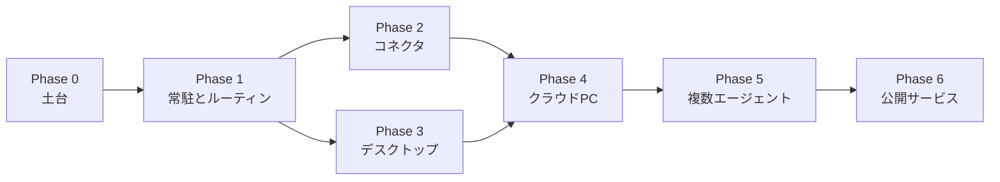

# ヤタ ロードマップ

ヤタは、いつも側にいて、自分のコンピュータを持つ個人エージェントを目指しています。八咫烏が神武天皇の前を飛んで道を示したように、調べて、読んで、必要なときだけ手を動かし、危ないところでは止まります。目指す種類は Grok Bot、Meta Muse、OpenAI Dots と同じです。チャットの返事係ではなく、人が席を外していても動ける案内役です。この文書は、ZEN University で作りながら毎日使い、ポートフォリオに載せ、いつか人に渡すための地図です。機能の実装計画であって、ここに書いたものはまだ入っていません。

## いまあるもの (MVP)

Phase 0 として、ローカルで一通り動きます。`./scripts/run.sh` のあと、ブラウザで http://127.0.0.1:8741 を開きます。

- **エージェントループ。** モデルが考え、ツールを呼び、結果を見て、また考える。1 ターンの上限は既定 8 ステップ（`YATA_MAX_STEPS`）。途中の `tool_call` や `tool_result` は SSE でチャットに流れる。トークン単位の生成ストリームはまだない。
- **差し替えできる LLM。** Gemini、OpenAI、Anthropic Claude、Ollama などの OpenAI 互換エンドポイント。画面のモデル選択と `YATA_MODEL` で切り替える。キーは `.env`。未設定のプロバイダは「利用不可」になり、送信前に API が断る。
- **デモモデル。** キーがなくても、本物のループと本物のツールで流れを確認できる。回答の品質を見るためのものではない。
- **ウェブ検索。** DuckDuckGo（`ddgs`、API キー不要）。
- **ページの取得。** HTTP で取り、本文だけを抜く。リダイレクトのたびに URL を検査する。`169.254.169.254` と `metadata.google.internal` は常に拒否する。プライベートアドレスは `YATA_ALLOW_PRIVATE_URLS`（個人利用の既定は `true`）。
- **Playwright のブラウザ。** 開く、本文を取る、クリック、入力、スクリーンショット。会話ごとに 1 ページのヘッドレス Chromium。クリックと入力は確認のあとで実行する。再起動するとログイン状態は残らない。
- **確認ゲート。** `Risk.MUTATE`（クリックと入力）は実行前にダイアログで止まる。`Risk.EXTERNAL`（将来のメール、決済、デスクトップ操作）も同じポリシーで止まる約束になっている。EXTERNAL のツールはまだ 1 つもない。ゲートはプロセスのメモリ上なので、サーバーを落とすと待ちの確認は消える。
- **記憶。** SQLite に会話履歴と、`save_memory` で残した短い事実。事実は次の system プロンプトに入る。埋め込み検索や、手順を保存するスキルはまだない。
- **日本語のチャット UI。** React。返信、ツールの途中経過、モデル選択、確認ダイアログ。
- **テスト。** プロバイダ変換、ツール登録、モック LLM のループ、SQLite の記憶。`uv run pytest`。

サーバーのプロセスが動いているあいだのルーティンは入りました。まだないのは、ターミナルを閉じても残る Windows サービス、OS 通知、Gmail やカレンダー、トレイアプリ、専用の仮想マシン、複数エージェント、ログインして人に配る仕組みです。

## 目指す姿（共通の5本柱）

Grok Bot、Muse、Dots に共通するのは、モデルの賢さそのものより、エージェントが自分の環境を持ち、人がいない時間も動き、実生活の道具とつながり、危ない操作の前で止まり、経験が残ることです。ヤタもこの 5 本で見ます。

1. **自分のクラウド／常駐 PC。** ブラウザ、ファイル、ターミナルを、日常の操作と分けたコンピュータで持つ。いま持っているのは、会話のあいだだけのヘッドレス Chromium です。ファイルもシェルも、専用のマシンもありません。
2. **人不在でも動く。** 決めた時刻や間隔で調べ、結果を知らせる。いま動くのは、サーバーを起動してチャットを開いているあいだだけです。
3. **実生活連携。** Gmail、カレンダー、Slack など、すでに使っている場所とつながる。いまつながっているのは検索、ページ読解、その場のブラウザです。
4. **危険操作の確認ゲート。** 送る、買う、消す、ログインする、画面を操作する、の前に人が許可する。クリックと入力はすでに止まります。外へ出る操作は、同じゲートに乗せます。
5. **積み上がる記憶・スキル。** 短い事実だけでなく、一度見せた手順をスキルとして残し、また呼べる。いま残るのは会話履歴と、数行の事実です。

## 段階計画

先に常駐を作り、その上にコネクタとデスクトップの殻を載せ、それから専用のコンピュータと複数の役、最後に公開です。Phase 2 と Phase 3 は、Phase 1 のあとならどちらからでも着手できます。公開は最後です。

### Phase 0 — 土台（完了）

上の「いまあるもの」がこの段階です。ループ、モデルの差し替え、検索と読解、確認つきブラウザ、SQLite、日本語 UI、テスト。毎日の調べものに使え、コードを読めばどこにツールを足すかも分かります。ポートフォリオの最初の版として十分で、Grok Bot や Muse や Dots と比べる段階にはまだ早いです。

### Phase 1 — 常駐とルーティン（スケジューラまで完了）

ブラウザを閉じても、ヤタのプロセスが動いていればルーティンは実行されます。SQLite に cron か間隔を保存し、FastAPI の中の APScheduler が同じ `run_agent` を呼び、結果をそのルーティンの会話に残します。確認が必要な操作は、誰も見ていないあいだ「確認待ち」になり、次に開いた画面で許可できます。チャットに「毎朝8時にニュースを要約して」と送っても登録できます。

残しているのは、ターミナルを閉じてもプロセスが生きる Windows サービスと、OS の通知です。どちらも Phase 3 のトレイアプリと一緒に足します。それまでは `./scripts/run.sh` を起動したままにします。

### Phase 2 — コネクタ

実生活の入口は、メールと予定からです。

- Gmail と Google カレンダー。OAuth。トークンはローカルの秘密置き場に置き、git には入れない。
- 読み取りは、確認が重すぎない範囲で実行する。予定の参照や受信箱の要約は、送ることより軽い。
- 外へ出るメールは、先に下書きを作る。宛先と本文を確認ダイアログに出し、許可のあとで送信する。リスクは `Risk.EXTERNAL`。ループにメール専用の分岐は足さない。
- Slack と LINE は、メールと予定が安定してから。同じツールの形で足す。

### Phase 3 — デスクトップアプリ

中身のエージェントは FastAPI のままにします。殻だけをデスクトップにします。

- Electron または Tauri で、いまのウェブ UI を包む。
- システムトレイ、ログイン時の自動起動、ルーティン結果の OS 通知。
- ウィンドウを閉じてもプロセスは残る。停止はトレイから明示する。

新しいエージェントを殻の中に書き始めないこと。UI は今の React のまま載せます。

### Phase 4 — クラウド PC

一番重い段階です。Muse の Secure VM、Grok Bot の箱、Dots のデスクトップに相当するのはここです。ルーティンと、少なくとも 1 つのコネクタが動いてから着手します。先に箱だけ作ると、中でやることがありません。

- 日常の PC と分けた VM またはコンテナ。
- 再起動しても残るブラウザプロファイルとファイルシステム。
- 見たいときに見る画面。リモートデスクトップか、埋め込みの画面。途中で止められること。
- この箱を他人と共有し始めたら、プライベートアドレスは既定で拒否する。

### Phase 5 — 複数エージェントとスキル

1 人の汎用エージェントのままでは、手順が会話の中に溶けます。役を分け、手順を残します。

- 名前のついた専門エージェント。調べる役、文章にする役、予定を見る役。1 つの依頼の中で引き継ぐ。
- スキルは、プロンプトの文言だけではなく、実際に通ったツールの列から保存する。
- 保存したスキルは、Phase 1 のスケジューラから同じように呼べる。

### Phase 6 — 公開サービス

自分用とポートフォリオが安定してから、人に渡します。先に課金画面を作らない。

- 認証、会話の所有者、ブラウザセッションの分離。
- SQLite から、利用者ごとに分かれたデータベース（Postgres を想定）。
- 秘密の保管、利用量の上限、請求。
- `YATA_ALLOW_PRIVATE_URLS=false` を公開時の既定にする。URL 検査はリクエスト直前の名前解決なので、公開時はリダイレクトと DNS 再バインドも見直す。

収益の置き方は、汎用チャットで ChatGPT、Muse、Dots と正面から争うことではありません。八咫烏の名前に近い狭い領域（神社や旅の案内）か、相手の仕事に合わせた B2B の専用エージェントの方が、最初の商品になります。汎用のヤタは、自分用と作品の核として残します。

## やらないこと（当面）

- **モデルの性能競争。** 基盤モデルは作らない。Gemini、Claude、GPT、ローカルモデルを借りる。差は道具、常駐、確認、記憶に置く。
- **確認なしの PC 操作。** 画面全体のクリックやキー入力を足すときも `Risk.EXTERNAL` を通し、ブラウザのページ操作とはセッションを分ける。
- **秘密の同梱。** API キーも OAuth トークンも git に入れない。見本は `.env.example` だけ。

## 成功の定義

各段階で、できたかどうかを次のどれかで見ます。感想ではなく、手元で再現できることです。

| 段階 | できたと言えるとき |
| --- | --- |
| Phase 0（完了） | キー 1 つ、または demo で `./scripts/run.sh` が 8741 を開く。`uv run pytest` が通る。 |
| Phase 1（スケジューラまで完了） | サーバーが動いていれば、ブラウザを閉じても「毎朝 8 時にニュース要約」が会話に残る。ターミナルを閉じたあとも生かす Windows サービスは Phase 3。 |
| Phase 2 | カレンダーの予定をチャットから読める。メールは下書きまで作り、確認で許可したときだけ送信される。 |
| Phase 3 | ログイン時に起動し、ウィンドウを閉じてもトレイに残る。ルーティンの結果が OS の通知になる。 |
| Phase 4 | 再起動してもブラウザのログインと作業ファイルが残る。所有者はその画面を見て、途中で止められる。 |
| Phase 5 | 調べる役とまとめる役が 1 つの依頼で引き継ぐ。保存したスキルを、翌日のルーティンから呼べる。 |
| Phase 6 | 別アカウントから自分の会話と記憶が見えない。公開の既定でプライベートアドレスを拒否し、利用量に上限がある。 |

## English

Yata (ヤタ) is aimed at the same class of product as Grok Bot, Meta Muse, and OpenAI Dots: an always-on personal agent with its own computer. The name comes from Yatagarasu (八咫烏), the crow that showed Emperor Jimmu the way. This roadmap is for the owner, a student building it for daily use, a portfolio, and a later public product. Phase 0 and the in-process scheduler of Phase 1 are in place. A Windows service is not.

### What exists (Phase 0)

A local agent loop with a step cap and server-sent tool steps. Pluggable Gemini, OpenAI, Claude, and an OpenAI-compatible endpoint such as Ollama, plus a keyless demo model. DuckDuckGo search, page fetch with a URL guard, and a Playwright browser whose clicks and typing wait on a confirmation dialog. SQLite conversations and short facts. A Japanese React chat. `./scripts/run.sh` serves the API and the UI on one port. Tests cover providers, the tool registry, the loop, and memory.

Routines are stored in SQLite and run by an APScheduler tick inside the FastAPI process, including when the browser tab is closed. A run that needs confirmation stays `waiting_confirmation` until someone approves it. Not built yet: a Windows service or tray process, OS notifications, Gmail or calendar, a persistent VM, specialist agents, skills, and accounts. `Risk.EXTERNAL` is reserved for mail, payments, and desktop control, and no tool uses it yet. The confirmation gate is in memory. The browser profile does not survive a restart. There is no token streaming and no retrieved long-term memory.

### Five pillars

1. A computer of its own: browser, files, and a terminal, separate from the owner's daily machine.
2. Work while the owner is away: routines and a way to notice the result.
3. Real-life connectors: Gmail, calendar, and later Slack or LINE.
4. A confirmation gate before anything risky.
5. Memory and skills that accumulate.

### Phases

Phase 1's scheduler is in. A routine such as "summarize the news at 8:00 every morning" runs while the server process is up, and the result is waiting in chat. Surviving a closed terminal, via a Windows service or tray app, remains part of Phase 3.

Phase 2 adds Gmail and Google Calendar through OAuth. Tokens stay out of git. Outbound mail is a draft until the existing `Risk.EXTERNAL` gate is approved. Slack and LINE come after that. Success: calendar reads work from chat, and unapproved mail is never sent.

Phase 3 wraps the current web UI in Electron or Tauri. Tray, login auto-start, OS notifications. FastAPI stays the backend. Success: the window can close and the process remains, and a routine raises an OS notification.

Phase 4 is the isolated VM or container: a persistent browser profile, a filesystem, and a view the owner can watch and stop. This is the hardest step, and the one that matches a Muse Secure VM, a Grok Bot box, or a Dots desktop. Success: logins and files survive a restart, and the owner can see the screen.

Phase 5 names specialist agents that hand work to each other, and saves a skill from a demonstrated tool trace so a routine can run it again. Success: a research agent hands off to a writing agent in one task, and that saved skill is schedulable.

Phase 6 is the public product: auth, tenant isolation, Postgres, billing, rate limits, and private URLs off by default. A niche such as shrine or travel guidance, or a custom B2B agent, is a better first offer than a general assistant competing head-on with ChatGPT, Muse, or Dots.

Out of scope for now: competing on raw model quality, PC-wide control without confirmation, and committing secrets.
